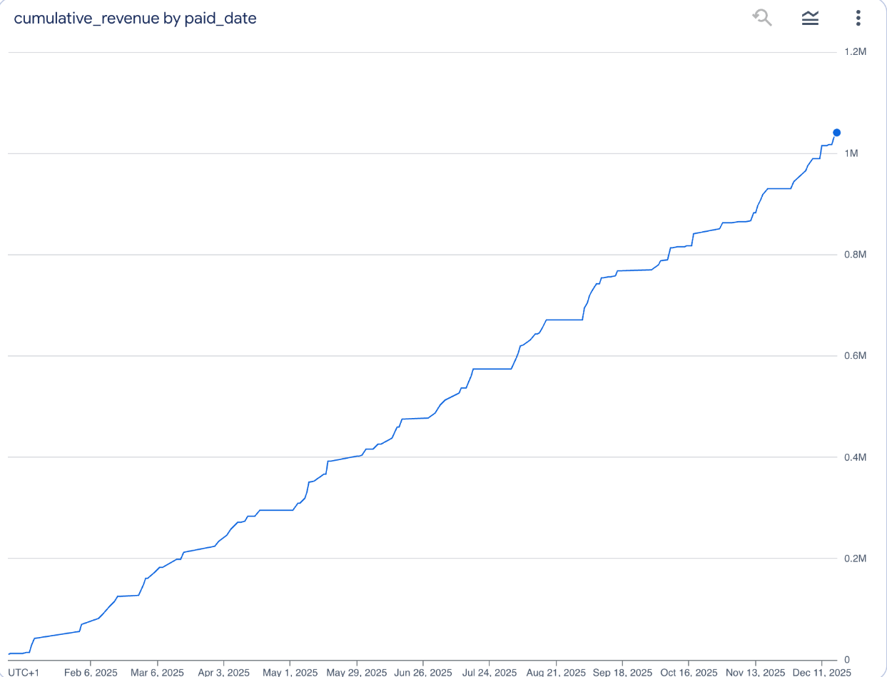

# CloudFlow year-end review in SQL

Analysis of **CloudFlow**, a file-sharing platform for businesses: user activity, churn risk and revenue in 2025, answered with six SQL queries in BigQuery.

## Data

The script `sql/cloudflow.sql` creates three tables in the `cloudflow` dataset:

| Table | Content |
| --- | --- |
| `users` | 40 business accounts in 3 countries, with their plan: Free, Pro or Enterprise |
| `activity_logs` | 6,424 actions of these users, from July 1 to December 31, 2025 |
| `invoices` | 224 monthly invoices of the paying accounts in 2025 |

## Business questions

| Question from the VP of Product | SQL technique |
| --- | --- |
| How many users are active each day? | `COUNT(DISTINCT)`, `GROUP BY` |
| What is the trend without the daily noise? | Moving average, `AVG() OVER` |
| Who are the top 3 uploaders per country? | `RANK() OVER (PARTITION BY)` |
| Which Enterprise accounts may churn? | Monthly change with `LAG()` |
| How much revenue came in each day? | Running total, `SUM() OVER` |
| When did we cross one million dollars? | Filter on the running total |

## Key findings

- CloudFlow collected **$1,041,780** in 2025 and crossed one million dollars on December 11.
- Two Enterprise accounts, Harbor Analytics and Groupe Hexa, lost at least half of their activity in December.

## How to run it

1. Open BigQuery in the Google Cloud console.
2. Run `sql/cloudflow.sql`: it creates the `cloudflow` dataset and its three tables.
3. Run the queries of `sql/analysis.sql` one by one.

## Tools

- Google BigQuery
- SQL: CTEs and window functions

## Author

Menyssa Cherifa, data analyst: [GitHub profile](https://github.com/clmenyssa)
